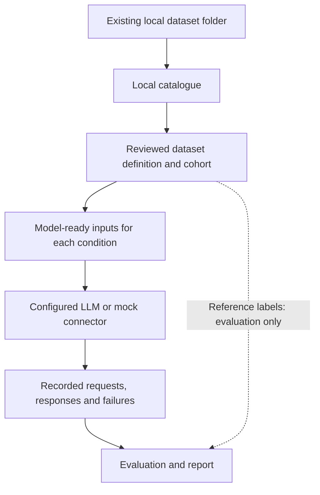

[[Home]] · [[Annotation Ablation Protocol]] · [[Experimental Pipeline Decisions]] · [[Scope and Research Question]]

# Experimental Pipeline

Updated: 2026-11-09. This page describes the experimental harness developed in the separate `agent_datasets` Python project. It is not a claim that the complete pipeline is implemented or that an experiment has produced results.

## Purpose

Prepare a reusable way to evaluate general-purpose multimodal LLMs on medical-imaging triage tasks, using locally available datasets and their reference annotations. The supervisor's direction, as reported in the research discussions, is to start with general-purpose LLMs for triage and later investigate planning around their outputs.

The harness and the Dicoogle agent are related but separate contributions. The harness studies model behaviour; Dicoogle contracts and deterministic validation study whether proposed tool plans are technically admissible. A favourable triage result does not establish plan validity or clinical suitability.

## Boundary: acquisition is external

The user chooses, downloads and organises datasets independently. The pipeline starts from an existing local folder containing images, annotations and declared label tables. There is no downloader, TCIA/IDC client, cloud discovery service or automatic retrieval of missing files. A missing local dependency is reported, not fetched.

A local catalogue only indexes files already on disk. Directory names are not treated as DICOM identity: headers and references link patients, studies, series, instances and annotation objects.

Remote LLM inference is a separate operation, enabled only by explicit model configuration and appropriate data-use permission. Local data processing does not require dataset-service access. Mock inference can run entirely offline.

## Processing flow

1. **Local catalogue.** Read DICOM headers and resolve annotation references. Identify missing targets and duplicate identifiers rather than silently selecting conflicting objects.
2. **Dataset definition and cohort.** A reviewed configuration declares label sources, mappings, eligibility, unit of analysis and known limitations. Deterministic code selects cases and records exclusions.
3. **Input preparation.** Render selected images and optional overlays using explicit parameters. Keep ground truth out of model-facing case records.
4. **Model interface.** Use a common request/response envelope, with a deterministic mock for tests and isolated provider adapters. New models using an existing protocol are configuration changes; genuinely new protocols may need an adapter.
5. **Execution.** Run cases × conditions × models × repetitions/seeds, preserve raw requests and responses, record failures and cost information, and resume from completed records.
6. **Evaluation.** Join predictions to separately stored labels, report coverage and uncertainty, compare conditions on matched cases, and retain negative or inconclusive findings.

Supported data formats and rules should be configurable. A genuinely new annotation format or label transformation may require an isolated adapter; the design does not promise universal dataset support without code changes.

## Experimental controls

- Labels and analysis-only fields are separated from model input. Text is allowlisted; identifying or diagnostic content is not exposed merely because it exists in a header or table.
- Class names in instructions are allowed; revealing the true class of the particular case is not. Tests use distinctive forbidden-content sentinels and structural separation, not bans on words such as benign or malignant.
- Conditions intended to isolate the display of an overlay use identical source images and slice selection. Annotation-guided localisation is explicitly disclosed.
- Input reuse checks configuration, templates, response schema, code identity and current local source-file metadata. Artifact integrity alone does not establish cache freshness. A missing required source yields a controlled input error.
- Model output uses a fixed, task-specific JSON envelope. Malformed or schema-invalid output is recorded, not silently repaired. Recorded code-fence extraction is a parsing operation, not a change to a predicted value.
- No scientific conclusion is inferred from successful software tests.

## Current implementation status

The following is developer-reported status from 2026-11-09, not an independent audit of the implementation repository:

| Area | Reported state | Evidence boundary |
|---|---|---|
| Application foundation | Completed: package structure, argparse CLI, entry-point separation from the exploration script, direct dependencies and import/help tests | 13 tests reported passing |
| External-access safeguards | Completed: offline connector-configuration guard, static import checks and socket-blocking pytest fixture | 29 total tests reported passing |
| Repository checkpoint | Commit `10359a5` reportedly contains the foundation and safeguards | User authorised the commit; not verified here against the implementation repository |
| Synthetic imaging fixture | Next implementation step | Not reported complete |
| Catalogue, cohorts, image preparation, inference runner and evaluation | Planned | No completed end-to-end experiment reported |

The runtime guard recognises mock and explicitly permitted loopback endpoints in offline mode. The test fixture blocks socket operations in the pytest process; it does not automatically sandbox subprocesses. These are development safeguards, not a complete security boundary.

## Next milestones

1. Generate a tiny synthetic CT/SEG/SR dataset and label table for offline tests.
2. Demonstrate local indexing and reproducible cohort construction on that fixture.
3. Build inputs and run both conditions with a mock model.
4. Produce an offline evaluation report from the mock run.
5. Validate supported behaviour on a selected real local dataset, then conduct a separately approved small real-model pilot.

LIDC-IDRI is an exploratory integration example, not a required final dataset. Model choice, final clinical task, dataset, slice policy and confirmatory statistical decisions remain open.
